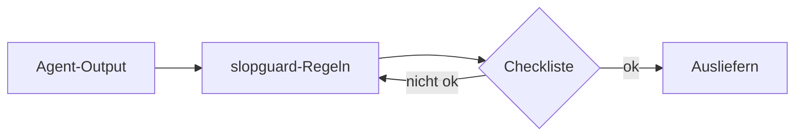
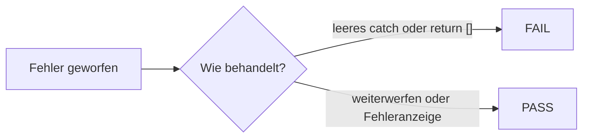
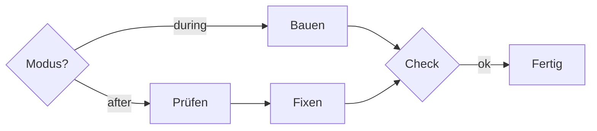

[English](README.md) | Deutsch

# slopguard

**Ein Filter für KI-Coding-Agenten.** Er hält generische UI, Floskeltext, überbauten Code und unehrliche Aussagen auf: erfundene APIs, „Tests laufen“ ohne Testlauf. Deutsch und Englisch.

slopguard ist kein Styleguide. Er lehnt Slop ab, wählt aber keine Farben, Schriften oder Marke aus. Die Richtung bestimmst du.



## Vorher und nachher

Derselbe Auftrag, einmal ohne und einmal mit Filter. Diese Muster fängt der Skill ab.

### Chat

| Vorher | Nachher |
|--------|---------|
| Gerne! Gute Frage! Hier ist ein umfassender Überblick, wie wir eine robuste Lösung nutzen können, um deinen Workflow nahtlos zu optimieren … | Der Login scheitert, weil das Token vor dem Refresh gelöscht wird. Die Stelle ist `auth.ts`, Zeile 42. |
| Ich hoffe, das hilft! Sag Bescheid, wenn ich noch Tests, Doku und ein Refactoring ergänzen soll. | `auth.ts` geändert. Tests nicht ausgeführt. |
| Es ist wichtig zu beachten, dass … | *(streichen, die Tatsache sagen)* |

### Commit-Nachricht

Commits bleiben meist englisch, deshalb sind die Beispiele englisch.

| Vorher | Nachher |
|--------|---------|
| `update code` | `Reject empty catch in invoice fetch so payment errors surface` |
| `improve UX` | `Show invoice due date in the list row` |
| `implement comprehensive solution` | `Add DATEV CSV export on the payroll page` |
| `This commit aims to unlock…` | *(neu schreiben: den Grund nennen, keine Werbung)* |

### Fehlerbehandlung

| Vorher | Nachher |
|--------|---------|
| `catch (e) { return []; }` | Weiterwerfen oder an die vorhandene Fehleranzeige geben |
| `catch (e) { console.log(e); }` | Mit dem Logger des Projekts loggen **und** den Fehler sichtbar machen |
| Leeres `catch {}` | Nicht erlaubt: beheben oder sichtbar scheitern |



### React

| Vorher | Nachher |
|--------|---------|
| `useEffect`, das nur `items` nach `filtered` kopiert | Beim Rendern filtern: `items.filter(...)` |
| `key={index}` in einer sortierbaren Liste | `key={item.id}` |
| Neue `utils/capitalize.ts` für einen Aufruf | Inline oder die vorhandene String-Behandlung nutzen |
| `"use client"` auf der ganzen Seite für einen Hook | `"use client"` nur an dieser Komponente |
| `UserServiceFactory` plus Interface für einen Aufrufer | `getUser(id)` mit dem vorhandenen Client |

### Hero und Werbetext

| Vorher | Nachher |
|--------|---------|
| Empower your workflow with seamless next-gen intelligence. Build faster. Scale smarter. | Export payroll as DATEV CSV in one click. |
| Trusted by teams at… · 99.9% Uptime · +127% Growth | *(ausgedachte Pills streichen, außer der Nutzer hat echte Zahlen geliefert)* |
| Für Teams, die mehr wollen. Einfach. Schnell. Sicher. | Offene Rechnungen. Ein Klick zur Freigabe. |

### Deutscher Fließtext

| Vorher | Nachher |
|--------|---------|
| Nicht nur schnell, sondern auch nachhaltig. Die Lösung ermöglicht es Teams, Mehrwert zu schaffen. | Der Export braucht unter zwei Sekunden. Die Liste zeigt offene Rechnungen und wer freigeben muss. |
| Im Hinblick auf die Herausforderungen und Chancen … | Beim Login scheitert der Refresh, weil … |
| Gerne! Gute Frage! | *(mit der Antwort anfangen)* |

### Muster im Aufbau (jede Sprache)

| Vorher | Nachher |
|--------|---------|
| Immer genau drei Aufzählungspunkte | 2, 4 oder 5, je nach Inhalt |
| Gedankenstrich in jedem Absatz | Höchstens einer pro Absatz |
| **Begriff**: Erklärung · **Begriff**: Erklärung | Fließtext oder eine echte Tabelle |
| Herausforderungen / Ausblick / Fazit, die das Lob wiederholen | Streichen oder einen konkreten nächsten Schritt nennen |

## Die zwei Modi



| Modus | Wann | Ablauf |
|-------|------|--------|
| **during** | Neue Arbeit | Filter beim Erzeugen, Checkliste vor dem Ausliefern |
| **after** | Vorhandener Entwurf, PR oder UI | Prüfen, Fundliste, deine Freigabe, Fix, erneut prüfen |

## Was abgedeckt ist

| Bereich | Datei |
|---------|-------|
| Regeln, Modi, Checkliste | [`skills/slopguard/SKILL.md`](skills/slopguard/SKILL.md) |
| Englische Wörter und Phrasen | [`skills/slopguard/references/en-blacklist.md`](skills/slopguard/references/en-blacklist.md) |
| Deutsche Wörter und Phrasen | [`skills/slopguard/references/de-blacklist.md`](skills/slopguard/references/de-blacklist.md) |
| UI-Klischees | [`skills/slopguard/references/ui-cliches.md`](skills/slopguard/references/ui-cliches.md) |
| Cursor-Regel, immer aktiv | [`rules/slopguard.mdc`](rules/slopguard.mdc) |
| Eine Datei zum Einfügen | [`slopguard.md`](slopguard.md) |

Die Regeln im Skill sind englisch. Modelle befolgen sie auch, wenn sie auf Deutsch antworten.

## Installation

### Skill (Cursor, Claude Code, Codex, skills.sh)

```bash
npx skills add taner-svg/slopguard
```

### Cursor-Regel, immer aktiv

[`rules/slopguard.mdc`](rules/slopguard.mdc) nach `.cursor/rules/slopguard.mdc` in deinem Projekt kopieren.

### In jedes LLM einfügen

```bash
curl -o slopguard.md https://raw.githubusercontent.com/taner-svg/slopguard/main/slopguard.md
```

Den Inhalt in Custom Instructions oder den System-Prompt einfügen.

Installation, Update und Entfernen pro Agent: [GUIDE.md](GUIDE.md) (englisch).

## Aufbau des Repos

```
skills/slopguard/SKILL.md     # Kern-Skill
skills/slopguard/references/  # EN/DE-Wortlisten, UI-Klischees
rules/slopguard.mdc           # Cursor-Regel, immer aktiv
slopguard.md                  # eine Datei zum Einfügen
AGENTS.md                     # kurzer Verweis für Agenten
GUIDE.md                      # Installation / Update / Entfernen
README.de.md                  # diese Seite
```

## Checkliste vor dem Ausliefern (Kurzfassung)

Vor dem Ausliefern (**during**) oder nach dem Umschreiben (**after**):

- [ ] Der Diff enthält nur, was verlangt war
- [ ] Keine neue Dependency oder Abstraktion ohne Auftrag
- [ ] Kein geschluckter Fehler, kein TODO, keine erfundene API
- [ ] Keine Template-UI, außer sie wurde verlangt
- [ ] Keine neuen Floskeln aus den EN/DE-Listen
- [ ] Kein „nicht nur … sondern“, kein „Es ist nicht X, es ist Y“
- [ ] Listenlänge aus dem Inhalt, nicht aus der Dreierregel
- [ ] Höchstens ein Gedankenstrich pro Absatz
- [ ] Der Chat beginnt mit der Antwort
- [ ] „Tests laufen“ nur nach einem Testlauf

Vollständige Liste: am Ende von [`SKILL.md`](skills/slopguard/SKILL.md).

## Lizenz

MIT. Siehe [LICENSE](LICENSE).
