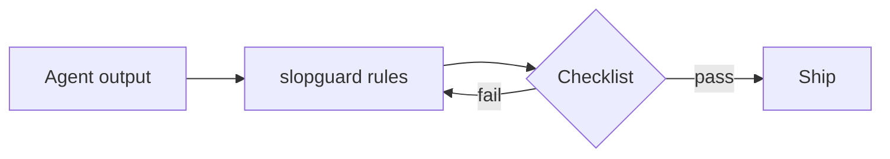
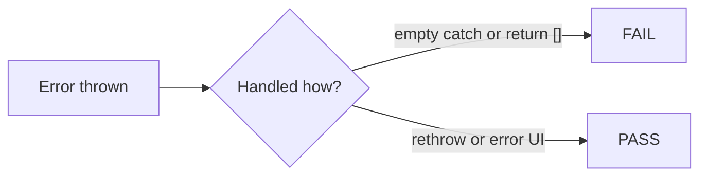
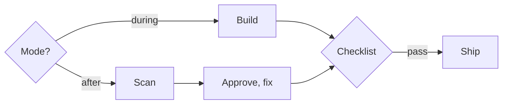

English | [Deutsch](README.de.md)

# slopguard

**A filter for AI coding agents.** Stops generic UI, filler copy, over-engineered code, and dishonest claims (invented APIs, “tests pass” without a run). DE and EN.

Not a style guide. It rejects slop; it does not pick your colors, fonts, or brand. Direction stays yours.



## See the difference

Same brief, before and after the filter. These are the patterns the skill is built to catch.

### Chat

| Before | After |
|--------|--------|
| Sure! I'd be happy to help. Great question! Here's a comprehensive overview of how we can leverage a robust solution to seamlessly optimize your workflow… | The login fails because the token is cleared before refresh. Fix is in `auth.ts` line 42. |
| I hope this helps! Let me know if you'd like me to also add tests, docs, and a refactor. | Changed `auth.ts`. Tests not run. |
| Importantly, it is worth noting that… | *(deleted, say the fact)* |

### Commit message

| Before | After |
|--------|--------|
| `update code` | `Reject empty catch in invoice fetch so payment errors surface` |
| `improve UX` | `Show invoice due date in the list row` |
| `implement comprehensive solution` | `Add DATEV CSV export on the payroll page` |
| `This commit aims to unlock…` | *(rewrite: name the reason, no hype)* |

### Error handling

| Before | After |
|--------|--------|
| `catch (e) { return []; }` | Rethrow or pass to the existing error UI |
| `catch (e) { console.log(e); }` | Log with the project logger **and** surface failure |
| Empty `catch {}` | Not allowed: fix or fail visibly |



### React

| Before | After |
|--------|--------|
| `useEffect` that only copies `items` → `filtered` | Filter in render: `items.filter(...)` |
| `key={index}` on a sortable list | `key={item.id}` |
| New `utils/capitalize.ts` for one call | Inline or use existing string handling |
| `"use client"` on the whole page for one hook | `"use client"` only on that component |
| `UserServiceFactory` + interface for one caller | `getUser(id)` with the existing client |

### Hero / marketing copy

| Before | After |
|--------|--------|
| Empower your workflow with seamless next-gen intelligence. Build faster. Scale smarter. | Export payroll as DATEV CSV in one click. |
| Trusted by teams at… · 99.9% Uptime · +127% Growth | *(remove fake pills unless the user supplied real numbers)* |
| Für Teams, die mehr wollen. Einfach. Schnell. Sicher. | Offene Rechnungen. Ein Klick zur Freigabe. |

### German prose

| Before | After |
|--------|--------|
| Nicht nur schnell, sondern auch nachhaltig. Die Lösung ermöglicht es Teams, Mehrwert zu schaffen. | Der Export braucht unter zwei Sekunden. Die Liste zeigt offene Rechnungen und wer freigeben muss. |
| Im Hinblick auf die Herausforderungen und Chancen… | Beim Login scheitert der Refresh, weil… |
| Gerne! Gute Frage! | *(start with the answer)* |

### Structure tells (any language)

| Before | After |
|--------|--------|
| Exactly three bullets every time | 2, 4, or 5, whatever fits |
| Em dash in every paragraph | At most one per paragraph |
| **Term**: explanation · **Term**: explanation | Prose or a real table |
| Challenges / Outlook / Conclusion that restate praise | Cut or write a concrete next step |

## How modes work



| Mode | When | Flow |
|------|------|------|
| **during** | New work | Filter while generating, checklist before ship |
| **after** | Existing draft, PR, or UI | Scan, findings table, your approval, fix, re-scan |

## What it covers

| Area | File |
|------|------|
| Rules, modes, checklist | [`skills/slopguard/SKILL.md`](skills/slopguard/SKILL.md) |
| English banned words and phrases | [`skills/slopguard/references/en-blacklist.md`](skills/slopguard/references/en-blacklist.md) |
| German banned words and phrases | [`skills/slopguard/references/de-blacklist.md`](skills/slopguard/references/de-blacklist.md) |
| UI cliché defaults | [`skills/slopguard/references/ui-cliches.md`](skills/slopguard/references/ui-cliches.md) |
| Cursor always-on | [`rules/slopguard.mdc`](rules/slopguard.mdc) |
| Single paste file | [`slopguard.md`](slopguard.md) |

## Install

### Skill (Cursor, Claude Code, Codex, skills.sh)

```bash
npx skills add taner-svg/slopguard
```

### Cursor always-on rule

Copy [`rules/slopguard.mdc`](rules/slopguard.mdc) to `.cursor/rules/slopguard.mdc` in your project.

### Paste into any LLM

```bash
curl -o slopguard.md https://raw.githubusercontent.com/taner-svg/slopguard/main/slopguard.md
```

Put the contents in Custom Instructions or the system prompt.

Full install, update, and remove per agent: [GUIDE.md](GUIDE.md).

## Repository layout

```
skills/slopguard/SKILL.md     # core skill
skills/slopguard/references/  # EN/DE blacklists, UI clichés
rules/slopguard.mdc           # Cursor always-on rule
slopguard.md                  # single paste file
AGENTS.md                     # compact agent pointer
GUIDE.md                      # install / update / remove
README.de.md                  # German start page
```

## Delivery checklist (summary)

Before ship (**during**) or after rewrite (**after**):

- [ ] Diff only what was asked
- [ ] No new dependency or abstraction without a request
- [ ] No swallowed error, TODO, or invented API
- [ ] No template UI defaults unless asked
- [ ] No new EN/DE blacklist filler
- [ ] No “not only… but” / “It’s not X, it’s Y”
- [ ] List length from content, not the rule of three
- [ ] At most one em dash per paragraph
- [ ] Chat starts with the answer
- [ ] “Tests pass” only if they ran

Full list: end of [`SKILL.md`](skills/slopguard/SKILL.md).

## License

MIT. See [LICENSE](LICENSE).
